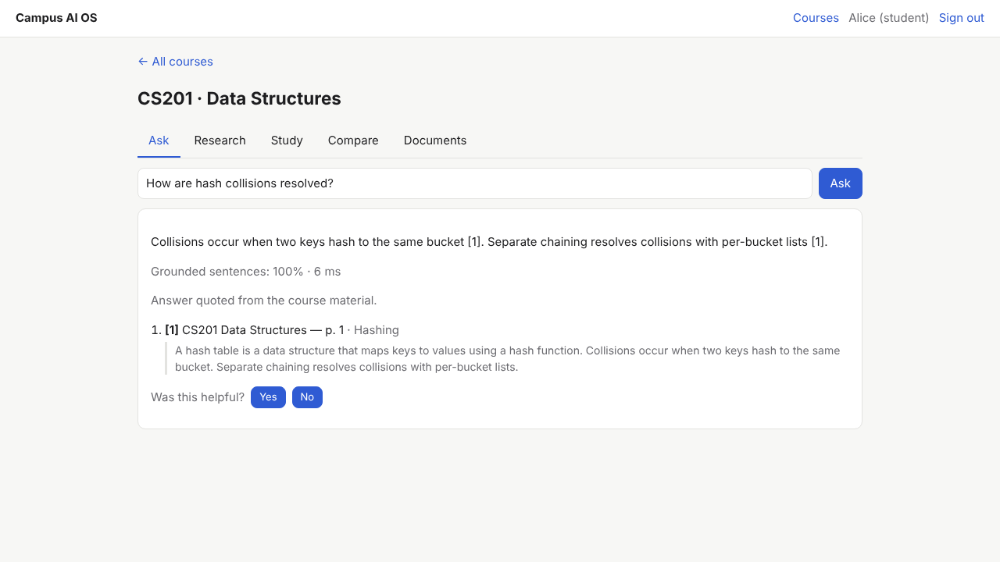
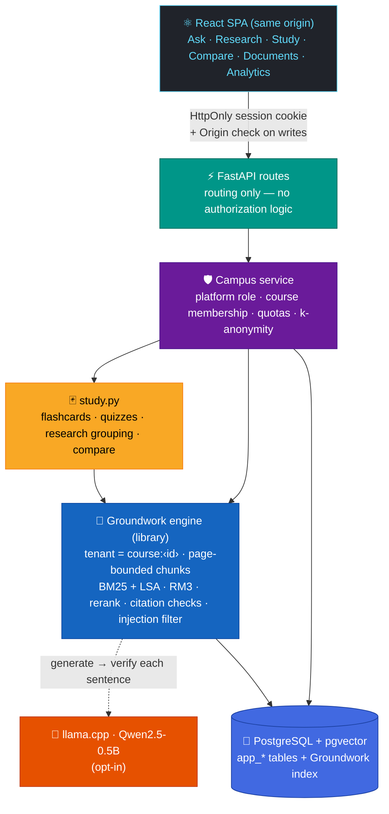
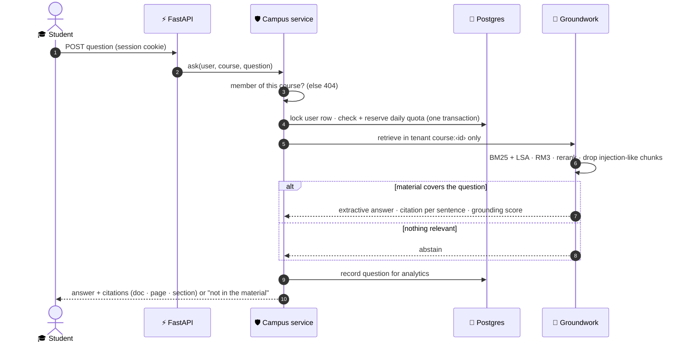
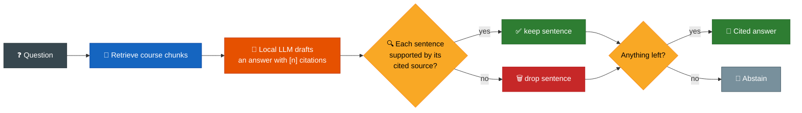
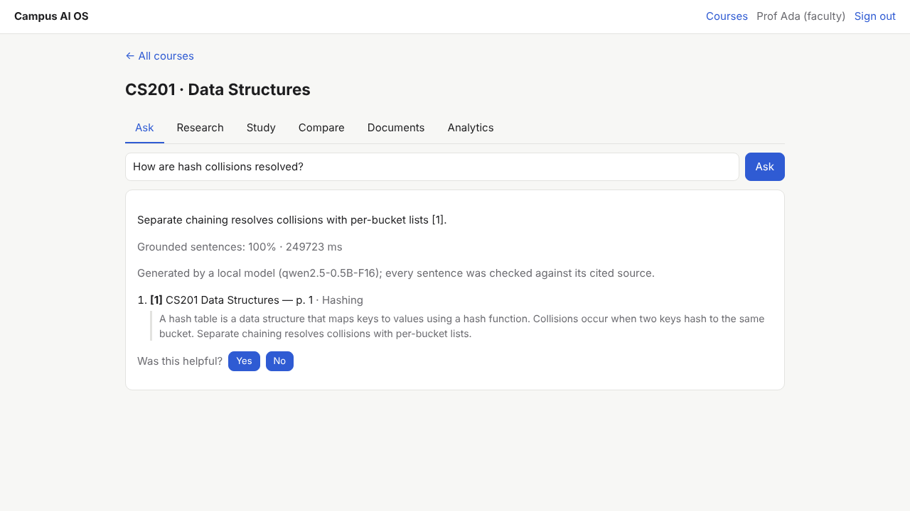
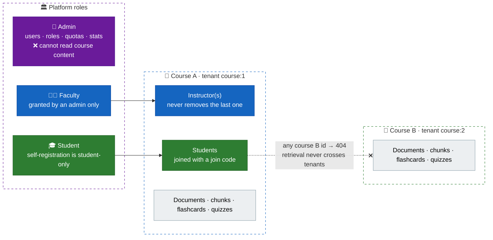
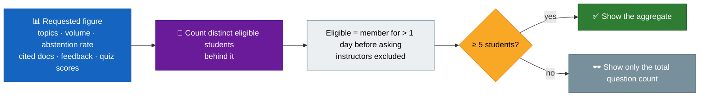
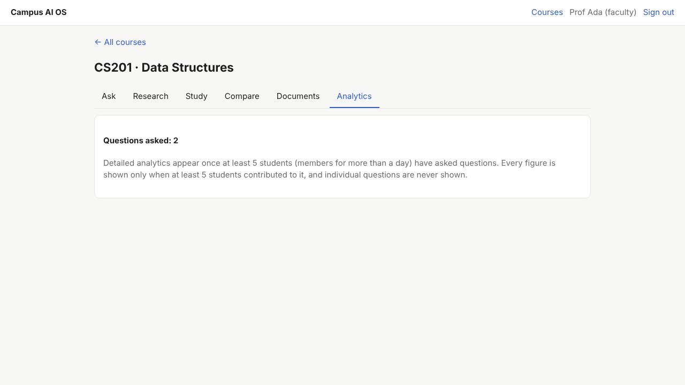
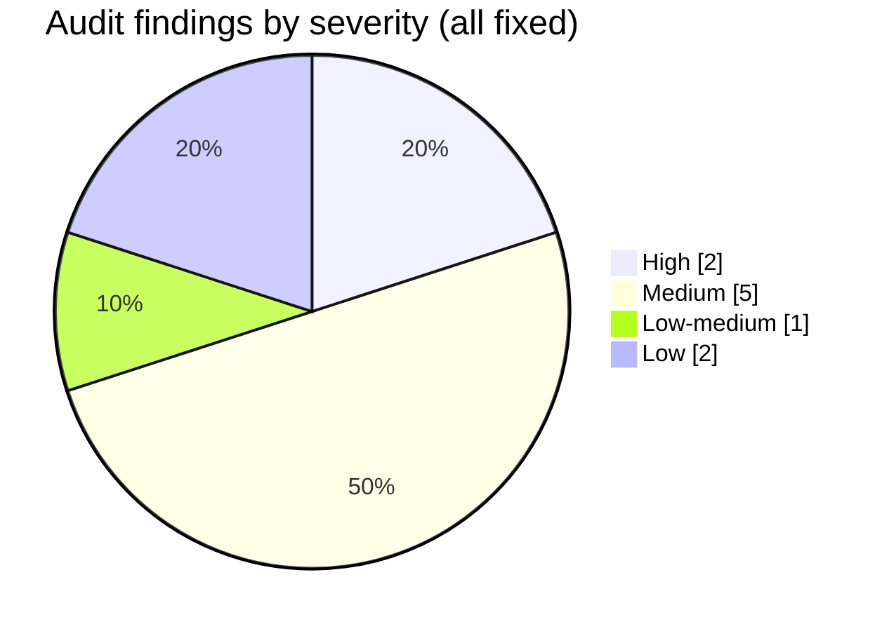
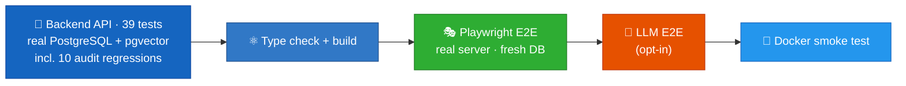

<div align="center">

# 🎓 Campus AI OS

### A multi-tenant course knowledge platform — every answer cited, every course isolated, every student anonymous

**Grounded Q&A with sentence-level citations · abstains instead of inventing · flashcards & quizzes from the course's own text · k-anonymous instructor analytics**

<br/>


-E65100?style=flat-square)


<br/>



<sub>A student asks a question. Every sentence of the answer is quoted from the course material and cites the document, page and section.</sub>

</div>

---

## ⚡ TL;DR

Instructors upload lecture notes, slides (PDF), handouts and syllabi. Students ask questions and get answers **built only from that material**:

- 📌 **Every sentence carries a citation** — document, page, section — plus a grounding score.
- 🛑 **It abstains** when the material doesn't contain the answer, instead of making something up.
- 🃏 **Study tools** — flashcards, cloze quizzes, a research view and document comparison — are extracted from the same text, so every item points back to a page.
- 🕶️ **Instructors see analytics, never individuals.** Every figure needs at least 5 distinct eligible students behind it.
- 🧱 **Each course is an isolated tenant**, enforced twice: in the service layer *and* in the retrieval engine.
- 🤖 **Optional local LLM answers** (Qwen2.5-0.5B via llama.cpp, CPU) — with every generated sentence checked against its cited source; unsupported sentences are dropped.

> [!NOTE]
> **Security was attacked, not assumed.** An independent adversarial review reproduced **10 defects** against a live server — including 2 high-severity ones (a demoted faculty member keeping instructor rights, and analytics that could identify a single student). All 10 are fixed, and each has its own regression test.

---

## 🏗️ Architecture



The retrieval and grounding engine is **[Groundwork](https://github.com/siddhaantxsingh/GROUNDWORK)**, my separate RAG engine, used here as a library. Campus AI OS adds everything a real multi-user product needs on top: accounts, roles, tenancy, quotas, privacy, study tools and a UI.

---

## 💬 How a question is answered



### Opt-in LLM answers — generated, then verified



The checker would rather abstain than show an unsupported sentence — with a 0.5B model that is a frequent outcome, and a deliberate one.

<div align="center">

</div>

---

## 🧱 Tenancy, roles and privacy



### k-anonymous instructor analytics



Students should be able to ask "naive" questions without being identifiable. The one-day membership rule exists because the audit showed **4 fresh sock-puppet accounts** could push a single student's topic over the threshold ([ADR 0003](docs/decisions/0003-k-anonymous-analytics.md)).

---

## ✨ Features

| Area | What exists |
|---|---|
| 🔐 **Accounts** | Email + password (scrypt, N=2¹⁵) with HttpOnly session cookies; logout and password change revoke sessions; self-service account deletion |
| 👥 **Roles (RBAC)** | Platform: admin, faculty, student. Course: instructor, student. Join codes for students; instructors can be added and removed, but never the last one |
| 🧱 **Course workspaces** | Each course is an isolated retrieval tenant — members only, any other id returns 404 |
| 📄 **Documents** | PDF (page-aware), Markdown, HTML, text. Idempotent upload. Deleting a document also deletes its flashcards and any quiz that quotes it |
| 💬 **Ask** | Grounded extractive answers with per-sentence citations and a grounding score, or opt-in local-LLM answers with the same checks. Injection-like chunks are excluded |
| 🔬 **Research** | RM3-expanded retrieval with reranking; evidence grouped by document, with pages |
| 🃏 **Study** | Flashcards from definitional sentences; cloze multiple-choice quizzes whose answers stay hidden until submission, with source pages in the results |
| ⚖️ **Compare** | Key terms shared by and distinctive to two documents, plus matching sections with similarity scores |
| 📊 **Analytics** | k-anonymous (k = 5) volume, abstention rate, topics, most-cited documents, feedback, quiz scores |
| 🚦 **Quotas** | Daily questions per user and storage per course — correct under concurrent requests |
| 👍 **Feedback** | Thumbs up/down and a comment, on your own answers only |
| 🛠️ **Admin** | Users, roles, disable (revokes sessions), per-user quotas, platform stats — but no access to course content |

<details>
<summary><b>📸 More screenshots</b></summary>

<br/>

**Analytics below the k threshold — the instructor sees only a total:**



**Quiz with source pages after submission:** [`docs/screenshots/quiz.png`](docs/screenshots/quiz.png)

</details>

---

## 🔐 Security audit — 10 defects found, reproduced and fixed

An independent adversarial reviewer with read-only access reproduced every claim with a script against a live server and database. Full report: [`docs/audit.md`](docs/audit.md).



| ID | Severity | Defect (reproduced) | Fix |
|---|---|---|---|
| C1 | 🔴 high | Faculty demoted to student kept instructor rights | Instructor actions need membership **and** a faculty/admin platform role; demotion converts memberships |
| C2 | 🔴 high | Analytics exposed single students; 4 sock-puppets pushed one student over k=5 | Every breakdown needs ≥ k eligible students; eligibility needs > 1 day of membership |
| C3 | 🟠 medium | Account deletion kept feedback comments and question text | Free text erased; only anonymous counts kept |
| C4 | 🟠 medium | 20 parallel questions with quota 1 recorded 4 | Quota check + reservation in one transaction with a row lock |
| C5 | 🟠 medium | 10 parallel uploads reached 2× the storage quota | Check–ingest–record serialized per course |
| C6 | 🟠 medium | Instructor quizzes vanished when the instructor deleted their account | `official` stored at creation; last instructor can't delete their account |
| C7 | 🟡 low-med | Quizzes kept sentences of a deleted document | Deleting a document deletes quizzes quoting it |
| C8 | 🟠 medium | Compare built an \|A\|×\|B\| matrix under the global lock (2.3 s stall) | Snapshot under lock, blockwise compute outside, ≤ 2000 chunks per side |
| C9 | 🟢 low | Quiz prompt leaked later occurrences of the answer | Blank every whole-word occurrence |
| C10 | 🟢 low | Register / password change / deletion unlimited | Per-IP and per-user rate limits |

**Checked and clean:** CSRF (missing/`null` Origin, look-alike Referers), SPA path traversal, XSS sinks, cross-course document access, session fixation, quiz-answer exposure.

The browser E2E test also caught a **stemming bug in Groundwork** ("resolved" vs "resolves") that made a question miss the right sentence — fixed upstream with a regression test.

<details>
<summary><b>🛡️ Threat model (from <code>SECURITY.md</code>)</b></summary>

| Threat | Control |
|---|---|
| Cross-course access (IDOR) | Membership check on every operation + per-course retrieval tenant; foreign ids → 404 |
| Privilege escalation | Self-registration is student-only; faculty granted by admin |
| CSRF | SameSite=Lax cookie + exact Origin/Referer allow-list on every non-GET call |
| Session theft | Only SHA-256 of tokens stored; HttpOnly; 7-day expiry; revoked on logout, password change, disable |
| Password attacks | scrypt, constant-time compare, dummy hash for unknown emails, rate limits |
| Prompt injection in uploads | Groundwork excludes flagged chunks; extractive answers can't follow instructions |
| XSS | React escaping only; no raw HTML; CSP `default-src 'self'` |
| Resource exhaustion | Upload size, atomic storage and question quotas, compare caps, query length limits |

</details>

---

## 🧪 Testing



| Suite | Last result |
|---|---|
| Backend API (`cd backend && pytest`) | ✅ **39 passed** against real PostgreSQL + pgvector |
| Frontend type check + build | ✅ ok |
| Browser E2E (Chromium, real server, fresh DB) | ✅ passed |
| Browser E2E with a local LLM (opt-in) | ✅ passed |
| Docker image build + smoke test | ✅ `SMOKE OK` |

**The E2E story:** an admin promotes a registered user to faculty → faculty creates a course and uploads a document → a student registers, joins with the code, asks a question and gets a cited answer → gets an abstention on an off-topic question → browses flashcards → takes a quiz → the instructor's analytics stay hidden below k.

| Invariant | Covered by |
|---|---|
| Non-members get 404 for every course resource; admin role grants no content access | `test_non_members_cannot_see_course` |
| Demoted faculty lose instructor rights immediately | `test_c1_*` |
| Retrieval never crosses courses, even with foreign document ids | `test_courses_are_isolated_in_retrieval` |
| Quiz answers are never sent before an attempt | `test_quiz_hides_answers_and_grades` |
| Quotas hold under concurrency | `test_c4_*`, `test_c5_*` |
| Course deletion is resumable after a crash and invisible while in progress | `test_course_deletion_is_complete_and_resumable` |

Logs: [`test-logs/`](test-logs/) and [`docs/evidence/2026-10-15/`](docs/evidence/2026-10-15/).

---

## 🚀 Build, test, run

Requires the [Groundwork](https://github.com/siddhaantxsingh/GROUNDWORK) repo checked out next to this one, and PostgreSQL with pgvector.

```bash
pip install -e ../groundwork -e 'backend[dev]'
(cd frontend && npm ci && npm run build)

cd backend && pytest                      # 39 tests · PostgreSQL + pgvector on 127.0.0.1:5432
cd ../frontend && npx playwright test     # browser E2E against the real server and a fresh DB
```

**Run it:**

```bash
export CAMPUS_DATABASE_URL=postgresql://user:pass@db:5432/campus
export CAMPUS_ALLOWED_ORIGINS=https://campus.example.edu
export CAMPUS_BOOTSTRAP_ADMIN='admin@example.edu:<long random password>'   # first start only
export CAMPUS_STATIC_DIR=$PWD/frontend/dist CAMPUS_SECURE_COOKIES=1
cd backend && uvicorn --factory campus.app:create_app --host 0.0.0.0 --port 8000
```

**Docker:** `scripts/docker_build.sh campus-ai-os` (passes Groundwork as a named build context) → multi-stage image (Node build + Python 3.12-slim, non-root user, `/healthz` healthcheck). Optional LLM answers: `CAMPUS_LLM_PROVIDER=llamacpp`. More in [`docs/deployment.md`](docs/deployment.md).

---

## ⚖️ Engineering trade-offs

| Decision | Why | Record |
|---|---|---|
| **Extraction by default, generation opt-in** | Answers and study items are real sentences from the material, so nothing is invented | [ADR 0002](docs/decisions/0002-extractive-study-tools.md) |
| **Course = tenant** | Isolation enforced twice: service membership checks *and* engine tenant scoping | [ADR 0001](docs/decisions/0001-course-as-tenant.md) |
| **Privacy over insight** | Small courses see little analytics — by design | [ADR 0003](docs/decisions/0003-k-anonymous-analytics.md) |
| **Single process** | Simple and correct today; multi-replica needs advisory locks and a shared index | [architecture](docs/architecture.md) |

---

## 📁 Repository layout

```text
CAMPUS-AI-OS/
├── backend/
│   ├── campus/        # app.py (routes) · service.py (authz, quotas, k-anon) · study.py · auth.py · db.py
│   └── tests/         # test_campus.py · test_audit_regressions.py
├── frontend/
│   ├── src/           # React 19 + TypeScript SPA
│   └── e2e/           # Playwright specs (default + LLM)
├── scripts/           # docker_build · docker_smoke · e2e-server
├── docs/              # architecture · audit · testing · deployment · beta-plan · decisions/ · screenshots/ · evidence/
├── Dockerfile
└── SECURITY.md
```

---

## 🧭 Limitations and roadmap

**Honest status:** a working, end-to-end-verified vertical slice. Not yet deployed or used by real students.

| Next | Why |
|---|---|
| 🧑‍🎓 Beta with 1–2 real courses ([plan](docs/beta-plan.md)) | No usage or satisfaction data exists yet |
| 🤖 Larger LLM (local 3B or hosted), same citation checks | The 0.5B model is slow on CPU and abstains often after enforcement |
| 🔑 OIDC / university SSO, email verification, MFA | Accounts are email + password today |
| 📈 Advisory locks + shared index | Run multiple replicas |
| 🧠 Spaced-repetition flashcards | Study tools currently rely on definitional sentences |
| 🛡️ Differential privacy / verified enrolment | k-anonymity slows, but doesn't fully stop, a patient instructor creating accounts in advance |

Full list: [`docs/limitations.md`](docs/limitations.md).

---

<div align="center">

**Built so a student can trust every answer — and ask any question without being watched.**

<sub>MIT © siddhaantxsingh · Security reports: see <a href="SECURITY.md">SECURITY.md</a></sub>

</div>
